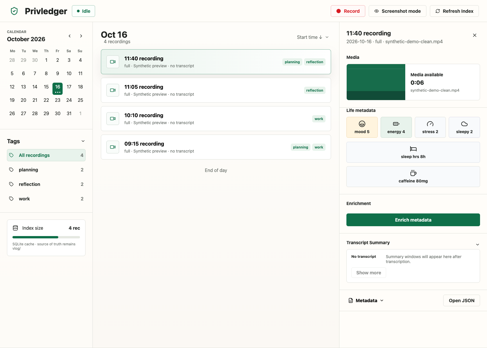
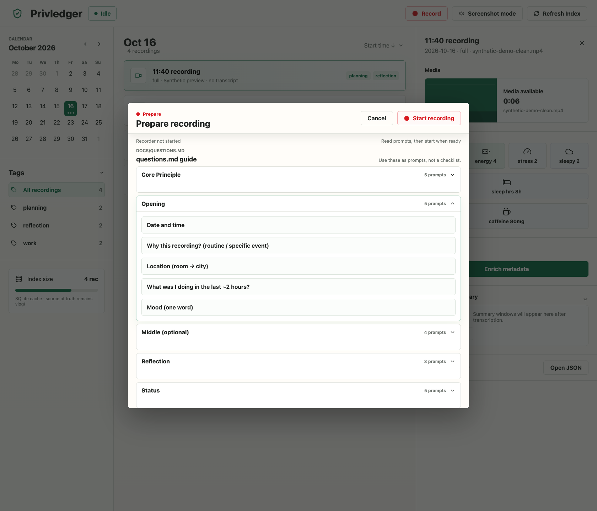
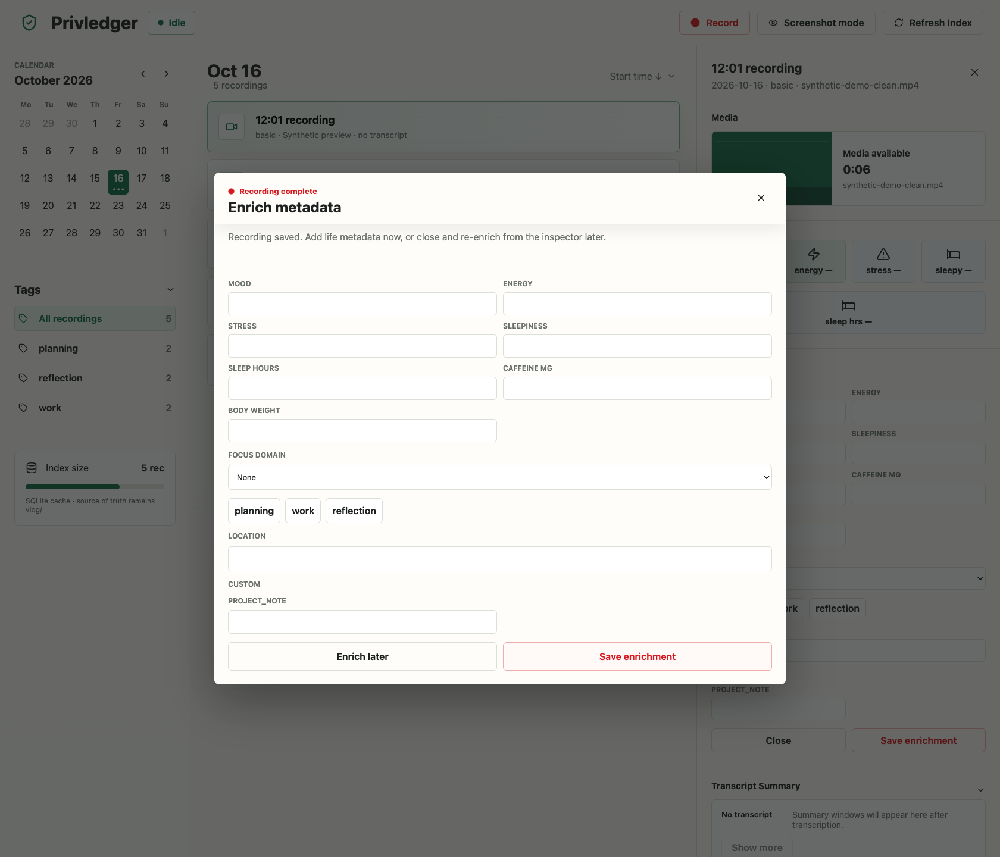

# Privledger

**A local video journal for your thoughts and the context around them.**

Record with optional prompts, add mood, sleep, and tags afterward, and revisit entries through a calendar. Your videos, transcripts, and metadata live as files on your machine.



*Browse recordings by day and tag, with the selected entry's context alongside it. All screenshots use synthetic metadata and generated media.*

## Why use it?

- Optional prompts give you somewhere to start when you have nothing to say.
- Mood, energy, stress, sleep, and tags keep the context attached to each recording.
- Calendar and tag filters help you return to an entry without searching through a folder of videos.

## From thought to journal entry

### Prepare and record



*Read the prompts, then start when you're ready. The guide stays available while you record.*

### Add context afterward



*After recording, add life metadata and tags. You can also enrich the entry later from the dashboard.*

## Get started

### Requirements

- macOS or Linux
- Python 3.10+
- Node.js 26.10.0 (verified runtime)
- npm
- ffmpeg and ffprobe
- Camera and microphone access for recording

Linux capture also uses v4l2 video devices, PulseAudio or PipeWire with `pactl`, and a VAAPI-capable ffmpeg setup. macOS capture uses the AVFoundation camera helper in `tools/avcam-cli`.

### Install

Create a Python environment and install the pipeline dependencies:

```bash
python3 -m venv .venv
source .venv/bin/activate
python -m pip install -r requirements.txt
```

Install the API and web dependencies:

```bash
cd apps/api && npm install
cd ../web && npm install
cd ../..
```

Initialize the macOS camera helper when using the macOS recorder:

```bash
git submodule update --init --recursive
```

Create local runtime configuration:

```bash
cp config/env.sample config/env
```

Edit `config/env` for the capture device and pipeline values. Linux and macOS capture requirements differ; use the [operations guide](docs/operations.md) for device discovery and troubleshooting.

### Run the web app

Start both local services:

```bash
./scripts/dev.sh start
```

Open the dashboard at [http://127.0.0.1:5173](http://127.0.0.1:5173). The API listens at [http://127.0.0.1:4577](http://127.0.0.1:4577).

Manage services with:

```bash
./scripts/dev.sh status
./scripts/dev.sh restart
./scripts/dev.sh stop
```

The API rebuilds its disposable SQLite index from `vlog/` at startup. The metadata and media files in `vlog/` remain the source of truth.

## CLI Use

The recorder and enrichment scripts can also run without the web app:

```bash
python3 scripts/privledger.py
python3 scripts/privledger.py --enrich
python3 scripts/enrich.py vlog/TS.json
```

The enrichment command accepts a timestamp, JSON filename, media filename, or path that resolves to a recording.

## Tests

```bash
python3 -m pytest -q
cd apps/api && npm test && npm run build
cd ../web && npm run build
npm run test:e2e
```

The browser suite uses a disposable workspace and a fake recorder. Real-camera verification is opt-in and requires local camera/microphone permissions:

```bash
npm run test:e2e:real
```

See [UI test instructions](docs/ui-test.md) for isolation behavior and test coverage.

## Documentation

- [Architecture](docs/arch.md): data flow, layer boundaries, invariants
- [Operations](docs/operations.md): platform setup, devices, recording, and troubleshooting
- [API](apps/api/README.md): endpoints, response shape, and settings
- [Metadata](docs/metadata.md): schema fields, writers, and validation
- [Enrichment](docs/enrichment.md): prompt flow and tag/focus behavior
- [Transcripts](docs/transcript.md): transcript sidecars and translation artifacts
- [Tags](docs/tags.md): tag semantics and usage
- [Test matrix](docs/test.md): pipeline behavior and failure cases
- [Recording guide](docs/questions.md): prompts for recording

## License

Privledger is licensed under the [MIT License](LICENSE). The `tools/avcam-cli` submodule retains its own MIT license and copyright notice.
